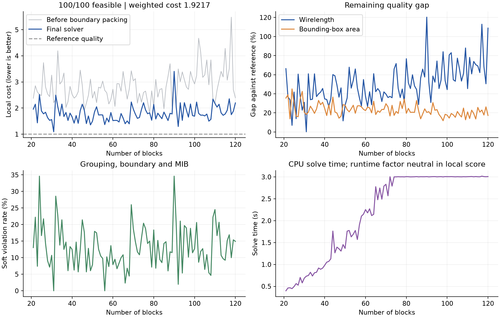
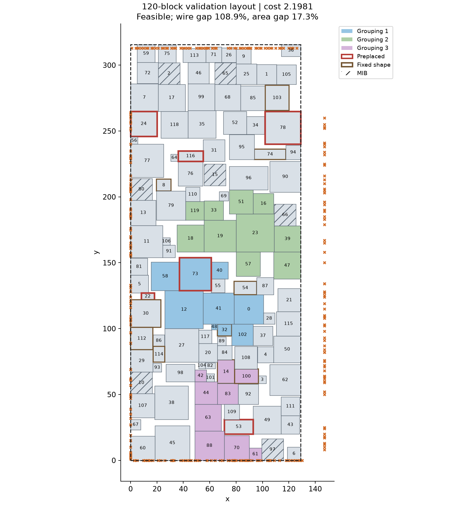

# The FloorSet Challenge: Data-Driven SoC Floorplanning

一个面向 **ICCAD 2026 FloorSet Challenge** 的 SoC 布局求解器。给定模块面积、连接关系、固定端口和布局约束，输出每个模块的 `(x, y, width, height)`。

实现采用连接图初始布局、边界优先矩形排布、线性规划压缩和局部搜索。使用未修改的官方评测器完成了 **100 个公开验证案例**，全部满足硬约束。

> 当前版本是经过公开验证的可运行解法，尚未评估隐藏测试或提交官方竞赛平台。仍有分组、边界软约束违规，结果不代表正式比赛排名。

## 验证结果

验证日期：**2026-10-08**。每个案例的默认搜索预算约为 3 秒；本地评分使用 `RuntimeFactor = 1`。

| 指标 | 结果 |
| --- | ---: |
| 验证规模 | 21–120 个模块，每种规模一个案例 |
| 可行案例 | **100 / 100** |
| 本地加权成本，越低越好 | **1.921661** |
| 平均求解时间 | **2.199 秒 / 案例** |
| 最短 / 最长求解时间 | 0.398 / 3.017 秒 |
| 模块重叠违规 | 0 |
| 软模块面积违规 | 0 |
| 固定尺寸、预放置违规 | 0 |
| MIB 尺寸违规 | 0 |
| 分组违规量，100 例合计 | 127 |
| 边界违规，100 例合计 | 464 |

加入边界优先布局后，完整验证集的成本从 **3.256692** 降到 **1.921661**，降低约 **41%**。两个版本都使用约 3 秒的搜索预算，均为 100/100 可行。

原始官方模板只运行了 21 和 120 模块两个对照案例，两例均不可行，成本均为 10；其中 120 模块案例耗时约 279 秒。没有对原始模板运行完整 100 例，不能把这个两例结果当作完整验证集成绩。

保存的最终布局已重新读取，通过官方评测器逐一复核全部硬约束及成本。另有 **8 项行为测试**和官方提交格式验证通过。



## 快速开始

建议使用 **Python 3.12**。Windows PowerShell 下执行以下命令；Linux/macOS 可将 `.venv\Scripts\python.exe` 替换为 `.venv/bin/python`，并用 `cp` 替换 `Copy-Item`。

### 1. 获取本项目及官方框架

```powershell
git clone https://github.com/ShanLinllllll/The-FloorSet-Challenge-Data-Driven-SoC-Floorplanning.git
cd The-FloorSet-Challenge-Data-Driven-SoC-Floorplanning

git clone https://github.com/IntelLabs/FloorSet.git FloorSet
git -C FloorSet checkout aadddcc2238695eb21e6542b8a6cd9e9fe6b80fa
Copy-Item my_optimizer.py FloorSet\iccad2026contest\my_optimizer.py
```

上面的官方提交是本报告实际使用的版本，其中已附带公开验证数据。官方框架及数据保留在本地 `FloorSet/`，不重复纳入本仓库版本管理。

### 2. 安装依赖

```powershell
python -m venv .venv
.\.venv\Scripts\python.exe -m pip install torch --index-url https://download.pytorch.org/whl/cpu
.\.venv\Scripts\python.exe -m pip install -r requirements-solver.txt
```

求解器使用 **SciPy**，因此请安装本仓库的依赖文件。`environment.txt` 记录了验证时实际使用的完整依赖版本。

### 3. 测试与完整验证

```powershell
$env:OMP_NUM_THREADS='1'
$env:MKL_NUM_THREADS='1'
$env:OPENBLAS_NUM_THREADS='1'
$env:FLOORSET_SECONDS='3'

.\.venv\Scripts\python.exe -X utf8 test_optimizer.py
.\.venv\Scripts\python.exe -X utf8 benchmark.py
```

`benchmark.py` 调用官方 `ContestEvaluator`，逐例保存布局、成本、运行时间和求解器 SHA256 至 `results/validation.json`。计时搜索在不同机器或负载下可能选择不同候选，因此重跑分数可能略有变化。

只调试指定案例：

```powershell
.\.venv\Scripts\python.exe -X utf8 benchmark.py --ids 0,39,99 --output results/custom_cases.json
```

案例编号为 0–99；编号 0 对应 21 模块，编号 99 对应 120 模块。`FLOORSET_SECONDS` 控制每道题的搜索预算，可以调大以投入更多优化。最后一次操作及最终检查可能让实际运行时间略超过预算。

### 4. 官方命令与结果复核

```powershell
$solverPython = (Resolve-Path '.venv\Scripts\python.exe').Path
Push-Location FloorSet\iccad2026contest
& $solverPython -X utf8 iccad2026_evaluate.py --validate my_optimizer.py
& $solverPython -X utf8 iccad2026_evaluate.py --evaluate my_optimizer.py --save-solutions
Pop-Location

.\.venv\Scripts\python.exe -X utf8 make_report.py
```

`make_report.py` 要求 `results/validation.json` 含有完整 100 例，会重新计算保存布局的官方成本和约束违规，并生成图表及 `results/verification.json`。

修改根目录的 `my_optimizer.py` 后，重新执行 `Copy-Item my_optimizer.py FloorSet\iccad2026contest\my_optimizer.py`，使官方评测器运行最新代码。

## 算法流程

1. **固定不可修改的几何信息。** 保留固定模块的宽高，保留预放置模块的坐标及宽高。普通软模块按目标面积生成尺寸，兼容的 MIB 成员使用相同宽高。
2. **估计初始位置。** 使用连接图的加权拉普拉斯方程，结合固定端口和预放置模块，计算中心位置；再通过连续优化减少连线距离和重叠。
3. **构造合法布局。** 枚举矩形边缘候选位置，构造无重叠布局。另生成一份边界优先候选：端口范围提供初始外框估计，带边界要求的预放置模块提供外框边，先安排角和边模块，再安排内部模块。
4. **压缩与优化。** 线性规划保留模块分离关系、已有分组接触及已满足的边界条件，优化加权曼哈顿距离并压缩外包矩形。
5. **局部搜索并复查。** 尝试无重叠移动和面积保持的形状调整，保留评分较好的候选；返回前再次检查全部硬约束。

外框只是产生候选布局的提示，并非额外的硬约束。坐标采用二进制网格，降低贴边时浮点误差产生微小空隙的风险。

求解器只使用 `solve()` 的输入，不读取数据文件、参考布局或数据生成器。官方评测器使用参考解计算成绩，并按照比赛接口提供固定模块所需的尺寸和预放置信息。内部搜索的质量尺度由输入估计，最终成绩使用官方参考指标重新计算。

## 接口与约束

```python
def solve(self, block_count, area_targets, b2b_connectivity,
          p2b_connectivity, pins_pos, constraints,
          target_positions=None):
    # 返回按模块编号排列的列表：
    # [(x0, y0, w0, h0), ..., (xn, yn, wn, hn)]
    ...
```

`x, y` 是模块左下角坐标。当前官方接口通过 `target_positions` 提供固定尺寸和预放置模块必须保留的几何信息。

| 类型 | 要求 |
| --- | --- |
| 硬约束 | 无重叠；普通软模块面积误差不超过 1%；固定尺寸不变；预放置位置和尺寸不变 |
| 软约束 | 分组模块通过非零长度共享边连通；MIB 成员宽高一致；模块触及指定外包矩形边或角 |

固定尺寸和预放置模块使用输入宽高，其目标面积字段不参与普通软模块面积检查。缺少必要固定几何信息，或预放置模块本身相互重叠时，求解器会报告错误。

## 120 模块布局示例

模块编号标在矩形中心。红框表示预放置模块，棕框表示固定尺寸模块，三种填充色表示分组，斜线表示 MIB 成员；橙色叉号为固定端口。



[查看可缩放的 SVG](results/layout_120.svg)

## 仓库文件

```text
.
├── my_optimizer.py                 # 求解器 / 提交文件
├── benchmark.py                    # 调用官方框架，保存完整验证结果
├── test_optimizer.py               # 8 项行为测试
├── make_report.py                  # 保存布局的独立复核与图表
├── package_solution.py             # 生成并校验解题包
├── requirements-solver.txt         # 所需依赖
├── environment.txt                 # 验证时的环境版本
├── floorset_solution.zip           # 已检查的解题包
├── submission_manifest.json        # 解题包文件的 SHA256
├── docs/
│   ├── problem_statement.pdf       # 题目说明
│   └── README_solution.md          # 原始交付说明
└── results/
    ├── validation.json             # 最终 100 例布局及官方成本
    ├── verification.json           # 独立复核结果
    ├── validation_before_boundary.json
    ├── template_smoke.json         # 原始模板的两个对照案例
    ├── validation_overview.png
    ├── layout_120.png
    └── layout_120.svg
```

## 当前限制与后续改进

- 已满足全部公开验证案例的硬约束，仍有分组和边界软约束违规。
- 线长与参考解仍存在差距，是后续优化的重要方向。
- 本地运行时间因子为 1；正式评分会比较各参赛提交在同一道题上的运行时间。
- 暂未训练机器学习模型，当前实现采用传统优化方法。
- 隐藏测试尚未评估，尚未向官方平台提交。

## 题目与工具来源

- [IntelLabs/FloorSet 官方仓库](https://github.com/IntelLabs/FloorSet)
- [ICCAD 2026 竞赛说明与评测框架](https://github.com/IntelLabs/FloorSet/tree/main/iccad2026contest)
- [本报告使用的官方提交](https://github.com/IntelLabs/FloorSet/tree/aadddcc2238695eb21e6542b8a6cd9e9fe6b80fa)

本仓库包含自定义求解器与验证产物。官方框架、数据及相关材料的权利归其原作者所有。
